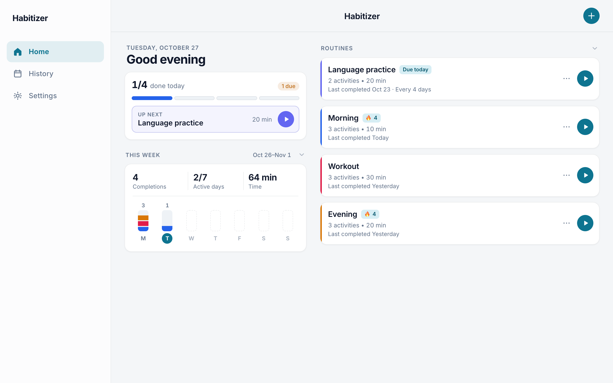
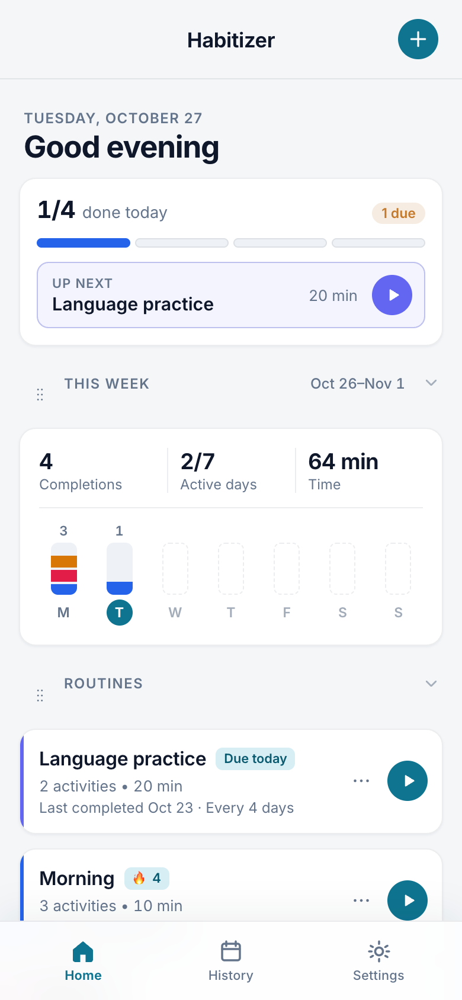
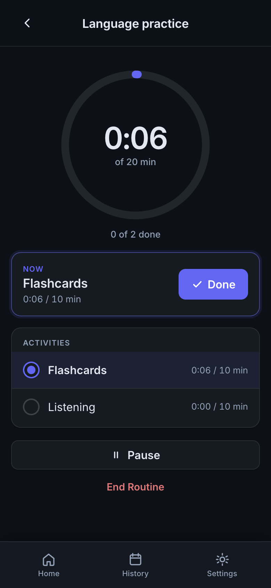
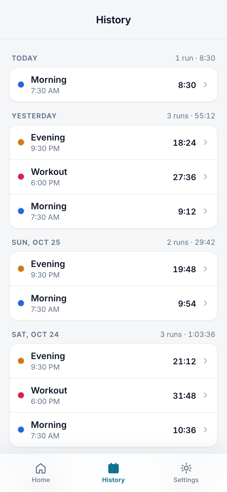

# Habitizer

**Build daily routines, run them with a step-by-step timer, and watch your streaks grow.**

### [▶ Try it now](https://amberouyang.github.io/habitizer/)

No sign-up needed. On the home screen, tap **Try sample routines** to explore with example data.



| Home | Timer | History |
|:---:|:---:|:---:|
|  |  |  |

Make a routine like "Morning" or "Workout," break it into steps, and run it with a built-in timer. Habitizer tracks your streaks and history so you can see your progress over time.

It's made for your phone, and you can add it to your home screen so it works like a regular app. It also works in a computer browser, with a sidebar layout on bigger screens.

## How it's built

- **Plain HTML, CSS, and JavaScript.** No framework, no build step, no dependencies in the app.
- **Works offline.** A service worker caches the app so it runs without a connection, and it installs to the home screen like a native app.
- **Private by design.** No accounts or servers. Everything is stored in the browser.
- **Safe saved data.** Saves are versioned and upgraded step by step, and corrupted data is backed up instead of crashing the app. Covered by [Vitest](https://vitest.dev) tests.
- **Three languages.** English, Español, and 中文.

## What you can do

- **Build routines.** Add steps, set how long each one should take, and pick a color.
- **Time yourself.** Tap ▶ to start. When you finish a step, the next one starts on its own.
- **Take a break.** Pause anytime, or leave the app and pick up where you left off.
- **Track streaks.** See how many days in a row you've finished a routine, plus a yearly activity chart.
- **Look back.** The History tab shows your past runs. Tap one to see that day's details.
- **Practice on a schedule (optional).** Turn on spaced practice and Habitizer spaces your sessions further apart as you get consistent: every 1, 2, 4, 7, 14, then 30 days.
- **Get reminders (optional).** Allow notifications and Habitizer will tell you when a routine is due.
- **Make it yours.** Dark mode, English / Español / 中文, sounds, and vibration on supported phones.

## Your data stays on your device

Habitizer has no accounts and no servers. Everything is saved in your browser on the device you're using.

That means:

- **Nobody else can see your data.**
- **Your data doesn't sync between devices.** Your phone and your computer each keep their own copy.
- **Clearing your browser data erases your routines.**

To keep a copy safe, go to **Settings → Backup → Export**. This downloads a backup file. Habitizer will remind you if it's been more than 14 days since your last backup.

To restore or move your data to another device, open **Settings → Backup → Import** and choose your backup file. You can **Merge** it with what's already there or **Replace all**.

## Add it to your home screen

Adding Habitizer to your home screen gives you an app icon and a full-screen view without the browser bars. You don't need the App Store.

**iPhone**

1. Open Habitizer in **Safari**.
2. Tap the **Share** button (square with an arrow).
3. Tap **Add to Home Screen**, then **Add**.

**Android**

1. Open Habitizer in **Chrome**.
2. Tap the **⋮** menu.
3. Tap **Install app** or **Add to Home screen**.

## How to use it

### Make your first routine

1. On the **Home** tab, tap **Add routine**.
2. Give it a name, an estimated time, and a color, then tap **Create**.
3. Add the steps you want to do, like "Stretch," "Shower," or "Make coffee."

### Run a routine

1. Tap ▶ on a routine.
2. Tap a step to start it. Tap it again when you're done, and the next step starts automatically.
3. Tap **Pause** if you need a break.
4. When you're finished, tap **End Routine** to see your results.

If you leave the app in the middle of a routine, a banner on the Home tab lets you jump back in.

### Use spaced practice

Spaced practice is good for things you want to keep up with but don't need to do every day.

1. Open a routine and turn on **Spaced practice**.
2. It's due today to start.
3. Each time you finish it on time, the gap before the next session gets longer. If you miss one, the gap shrinks a step.

Routines that are due or overdue show up at the top of your Home tab.

## Common questions

**Where did my routines go?**
Your data lives in the browser you used. If you switch browsers, use a different device, or open Habitizer from a different web address, you'll start fresh. Import a backup to bring your routines back.

**Why didn't my phone vibrate?**
Vibration only works on some phones, mostly Android. iPhones don't support it for web apps.

**Why am I not getting reminders?**
Make sure you turned on **Due reminders** in Settings and allowed notifications. On iPhone, reminders work best after you add Habitizer to your home screen.

**Can I delete a routine by accident?**
After you delete something, you get a few seconds to undo. Deleted routines also stay in **Settings → Recently deleted** for 30 days.

---

## For developers

Habitizer is plain HTML, CSS, and JavaScript with no build step. The app itself has no dependencies; `npm install` only adds the test tools.

### Run it locally

```bash
git clone https://github.com/amberouyang/habitizer.git
cd habitizer
npm run dev
```

Then open [http://localhost:8000](http://localhost:8000). (`npm run dev` runs `python3 serve.py --port 8000`, a small server with caching turned off.)

To test on a phone on the same Wi-Fi, open `http://YOUR_COMPUTER_IP:8000` on the phone.

Browser storage is separate for each address, so `localhost`, `127.0.0.1`, and your IP address each have their own data. Use Export and Import to move data between them.

### Project layout

```
index.html            App shell, settings, dialogs, launch splash
styles.css            All styles
manifest.webmanifest  Home screen install settings
sw.js                 Offline caching (off on localhost and LAN)
serve.py              Dev server with caching disabled
icons/                App icons
docs/screenshots/     Images used in this README
tests/                Vitest tests and sample saved data
js/
  main.js             Startup
  views.js            Home, History, routine, timer, and results screens
  timer.js            Live timer
  schedule.js         Spaced practice
  backup.js           Export, import, and backup reminder
  persistence.js      Saving and loading
  storage.js          The only place that touches localStorage
  migrations.js       Saved data versions and upgrades
  samples.js          Example routines for "Try sample routines"
  i18n.js             Translations
```

### Storage keys

All keys start with `habitizer_` so they can't clash with other apps on the same domain.

| Key | What it stores |
|-----|----------------|
| `habitizer_routines` | Routines, steps, completions, run history, spaced practice |
| `habitizer_settings` | Preferences and last backup date |
| `habitizer_deleted_routines` | Recently deleted routines (30 days) |
| `habitizer_timer_session` | The routine currently in progress |
| `habitizer_due_notified` | Which reminders were already sent today |
| `habitizer_demo_cleared` | One-time cleanup of old sample routines already ran |
| `habitizer_build` | App version, used to refresh cached files |

Older versions used names like `habitizer-routines-v1`. They are moved to the new names on startup (`LEGACY_KEY_RENAMES` in `js/constants.js`).

### Saved data versions

Routines, settings, deleted routines, the timer session, and reminder state are saved as `{ "version": N, "data": ... }`. On load, older data is upgraded one version at a time before the app uses it, and the original text is kept under `<key>_backup_v<N>`. To change a saved format, follow the steps at the top of `js/migrations.js`.

If saved data can't be read, the app doesn't crash: it copies the bad text to `<key>_corrupt_<timestamp>` and starts that part fresh.

### Tests

```bash
npm install
npm test
```

The tests in `tests/` load sample data from older versions (`tests/fixtures/`) and check that it upgrades correctly and that corrupted data doesn't crash the app. When you add a new data version, add a fixture for the version it replaces.
