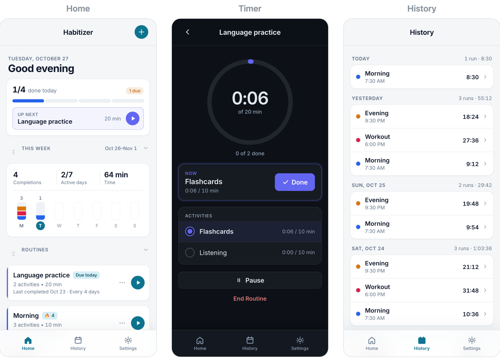

# Habitizer


[](https://github.com/amberouyang/habitizer/actions/workflows/test.yml)

A daily routine tracker that lives in your browser. Break a routine into steps, run it with a step-by-step timer, and watch your streaks grow.


## Try it

No sign-up or download needed.

1. Open **[amberouyang.github.io/habitizer](https://amberouyang.github.io/habitizer/)** on your phone or computer.
2. Tap **Try sample routines** to explore with example data, or **Add routine** to make your own.
3. On a phone, add it to your home screen so it opens like an app:
   - **iPhone:** in Safari, tap **Share**, then **Add to Home Screen**.
   - **Android:** in Chrome, tap **⋮**, then **Install app**.



## How to use it

1. Tap **Add routine**, give it a name and a color, and add steps like "Stretch" or "Make coffee."
2. Tap **▶** on a routine to start the timer.
3. Tap **Start** on a step, then **Done** when you finish. The next step is ready to go.
4. Tap **End Routine** to see your time and streak.
5. Open the **History** tab to look back at past runs.

| Do this | To do this |
|---|---|
| Tap **Pause**, or leave the app | Take a break. A banner on Home brings you back. |
| Turn on **Spaced practice** in a routine | Practice less often as you get consistent (every 1, 2, 4, 7, 14, then 30 days) |
| Turn on **Due reminders** in Settings | Get a notification when a routine is due |
| Tap **Undo** after deleting | Bring it back. Deleted routines also stay in **Settings → Recently deleted** for 30 days. |
| Go to **Settings** | Switch on dark mode, pick English, Español, or 中文, and turn sounds or vibration on or off |

## Troubleshooting

- **My routines are gone:** your data is saved in the browser you used. A different browser, device, or web address starts fresh. Import a backup to bring your routines back.
- **My phone didn't vibrate:** vibration only works on some phones, mostly Android. iPhones don't support it for web apps.
- **I'm not getting reminders:** turn on **Due reminders** in Settings and allow notifications. On iPhone, reminders work best after you add Habitizer to your home screen.

## Privacy

Habitizer has no accounts and no servers. Everything is saved in your browser on your device, so nobody else can see it. It doesn't sync between devices, and clearing your browser data erases it.

To keep a copy, go to **Settings → Backup → Export**. Habitizer reminds you if your last backup was more than 14 days ago. To restore or move to another device, use **Settings → Backup → Import**.

## For Developers

To run Habitizer on your own computer:

```bash
git clone https://github.com/amberouyang/habitizer.git
cd habitizer
npm run dev
```

Then open [http://localhost:8000](http://localhost:8000). To run the tests, use `npm install` and then `npm test`. GitHub Actions runs them on every push.

**Built with:** plain JavaScript, HTML, and CSS, with no framework and no build step. Tests use Vitest.

**How it works:** A service worker caches the app so it works offline and can be installed to the home screen. Routines are saved in `localStorage` as versioned data. When the format changes, older saves are upgraded one version at a time, and anything unreadable is backed up instead of crashing the app.

More details, including the project layout and storage format, are in [docs/DEVELOPMENT.md](docs/DEVELOPMENT.md).

## Author

Amber Ouyang ([@amberouyang](https://github.com/amberouyang))
